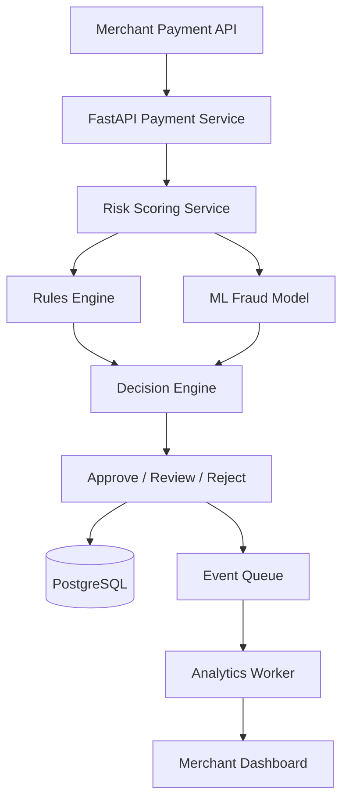

# Coinflow – Payment Risk & Fraud Monitoring

**A system design proposal for real-time payment risk assessment and fraud monitoring.**

## Overview

This proposal introduces a payment risk monitoring system that helps merchants identify suspicious transactions without unnecessarily slowing down legitimate payments.

The system combines rule-based validation with ML-based risk scoring to classify transactions into three outcomes:

- **Approve:** Low-risk transactions.
- **Review:** Transactions that require additional verification.
- **Reject:** High-risk transactions.

## 1. System Architecture

The proposed architecture separates payment processing, risk assessment, and analytics to keep the payment workflow responsive while supporting scalable fraud monitoring.



### Core Components

- **Payment Service:** Receives payment requests and validates incoming data.
- **Risk Scoring Service:** Evaluates transactions using rules and ML predictions.
- **Rules Engine:** Checks transaction patterns, velocity, and predefined risk conditions.
- **ML Fraud Model:** Identifies potentially suspicious transaction patterns.
- **Decision Engine:** Combines risk signals and determines the appropriate action.
- **Analytics Worker:** Processes transaction events asynchronously for reporting.

## 2. Technology Stack

| Component | Technology |
|---|---|
| Backend | Python, FastAPI |
| Database | PostgreSQL |
| Caching | Redis |
| Event Processing | Kafka |
| Fraud Detection | Machine Learning |
| Frontend | TypeScript |
| Infrastructure | Docker, CI/CD |

## 3. Data Model

**Payments**

| Field | Description |
|---|---|
| payment_id | Unique payment identifier |
| merchant_id | Merchant associated with payment |
| amount | Transaction amount |
| currency | Transaction currency |
| status | Payment status |
| created_at | Transaction timestamp |

**Risk Assessments**

| Field | Description |
|---|---|
| assessment_id | Unique assessment identifier |
| payment_id | Associated payment |
| risk_score | Calculated risk score |
| decision | Approve, review, or reject |
| model_version | Version of the model used |
| created_at | Assessment timestamp |

**Risk Signals**

| Field | Description |
|---|---|
| signal_id | Unique signal identifier |
| assessment_id | Associated risk assessment |
| signal_type | Type of detected risk |
| signal_value | Observed signal value |

## 4. API Design

**Endpoint**

`POST /v1/payments/{payment_id}/risk-assessment`

Example response:

```json
{
  "payment_id": "pay_123",
  "risk_score": 0.87,
  "decision": "review",
  "signals": [
    "velocity_anomaly",
    "unusual_amount"
  ]
}
```

The API returns a risk score, recommended decision, and the signals that contributed to the assessment.

## 5. Scaling and Reliability

- **Idempotency:** Use idempotency keys to prevent duplicate payment processing.
- **Asynchronous Processing:** Move analytics and reporting workloads to an event queue.
- **Database Optimization:** Add indexes on merchant_id, payment_id, and created_at.
- **Partitioning:** Partition historical transaction tables by date as data grows.
- **Caching:** Use Redis for frequently accessed merchant configurations and short-lived risk features.
- **Fault Tolerance:** Implement timeouts, retries, and fallback rules when the ML service is unavailable.
- **Monitoring:** Track API latency, queue delays, false-positive rates, and chargeback trends.

## 6. Architectural Trade-offs

Real-time risk scoring introduces additional latency to payment processing. A lightweight rules engine can handle straightforward checks quickly, while the ML model helps identify more complex patterns.

Keeping analytics asynchronous prevents reporting workloads from affecting payment processing. The system also needs a clearly defined fallback policy so payment decisions can continue safely if the ML service becomes unavailable.

## 7. Expected Impact

The proposed system aims to:

- Identify suspicious transactions earlier.
- Reduce manual fraud investigation.
- Improve visibility into payment risk patterns.
- Help merchants make more informed payment decisions.
- Maintain reliable payment processing as transaction volumes grow.

---

**Note:** This is a proposed system design created as part of a Coinflow engineering application exercise. It is an architectural proposal, not a deployed payment processing system.
